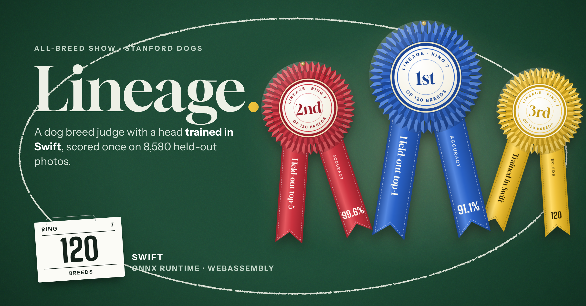

# Lineage

Identifying 120 dog breeds from a photo, with a classifier head trained from scratch in Swift on top of a pretrained MobileNetV4. Swift runs the network through ONNX Runtime's C API for training, and the same Swift code, compiled to WebAssembly, prepares the photo and runs the head in the browser.

**[Try the demo](https://evannwilsonn.github.io/lineage/)**: drop a dog photo into the show ring (or pick one of five CC0 samples) and the judge pins rosettes on its three most likely breeds. The photo never leaves your browser.

On the **8,580 photos of the official Stanford Dogs test split**, opened once at the end, the head names the right breed first **91.1%** of the time and has it in its top five **99.6%** of the time. The Zero to Mastery course notebook reports 87.7% with an EfficientNetV2-B0. One honest catch, explained in step 5: ImageNet's own classifier, with no training at all, gets 92.5% on the same photos, because the backbone has almost certainly seen many of them.

The project follows seven steps: problem, data, baseline, model, evaluation, improvement and deployment.



---

## 1. Problem

Given a photo of a dog, say which of 120 breeds it is. That's single-label image classification. The course does it the standard way, and so does this: take a network pretrained on ImageNet, keep it frozen as a feature extractor, and train only a new 120-way layer on top.

- **Metrics**: top-1 accuracy (the first guess is right) and top-5 (the right breed is among the five most likely), plus log loss to check the probabilities aren't overconfident.
- **The split is the official one**: 12,000 training photos (100 per breed) and 8,580 test photos (50 to 152 per breed). Every choice is made on a validation set carved out of the training photos. The course instead uses the test photos as its validation data while training, so its reported number had a look at the answers.
- **The page needs to give probabilities**, not just a label, and work for photos that aren't from the dataset.

## 2. Data

[Stanford Dogs](http://vision.stanford.edu/aditya86/ImageNetDogs/) (Aditya Khosla, Nityananda Jayadevaprakash, Bangpeng Yao and Li Fei-Fei, 2011): 20,580 photos of 120 breeds, built from ImageNet. The photos come from ImageNet and are under ImageNet's terms (non-commercial research and education), so none are in this repo or on the page. [`scripts/get-data`](scripts/get-data) streams the 750 MB `images.tar` straight through [`scripts/prepare_images.py`](scripts/prepare_images.py), which shrinks each photo so its shorter side is 272 px (650 MB on disk), and turns the official `.mat` split files into text lists. The tar is never stored. Details are in [data/README.md](data/README.md).

| Set | Photos | Used for |
|---|---|---|
| Fitting | 10,200 (85 per breed) | training heads while choosing settings |
| Validation | 1,800 (15 per breed, seed 42) | choosing every setting ([`results/split.json`](results/split.json)) |
| Final fit | 12,000 | the final head |
| **Test** | **8,580** | scored once at the end |

**The backbone** is [MobileNetV4 conv medium](https://huggingface.co/timm/mobilenetv4_conv_medium.e500_r256_in1k) from timm, trained on ImageNet-1k (about 80% top-1 there), Apache 2.0, in onnx-community's ONNX export. It's about the size of the course's EfficientNetV2-B0 (9.7 M parameters against 7.1 M; about 80% against 78.7% on ImageNet). [`scripts/make_backbone.py`](scripts/make_backbone.py) cuts it before its ImageNet classifier, so it outputs the 1,280-number embedding, and stores the weights as float16 with a cast back to float32 (the arithmetic stays float32), which brings it to 17 MB. Training and the page run that exact file.

**Embeddings are computed once.** `lineage embed` decodes each photo with libjpeg, prepares it in Swift and runs the backbone through ONNX Runtime's C API, in four views: the whole photo squeezed to 256 x 256 (what the course does), the backbone's own recipe (shorter side to 269, centre 256 x 256 crop), and both mirrored. That's 82,320 passes at 19 photos a second on two cores, about 18 minutes, into 420 MB of float32 (not committed).

## 3. Baseline

No head training at all, scored on the 1,800 validation photos ([`results/tuning.json`](results/tuning.json)):

| Validation, 1,800 photos | Squashed | Centre crop |
|---|---|---|
| Always the same breed | 0.8% | 0.8% |
| Nearest training photo (cosine) | 83.3% | 85.5% |
| 20 nearest training photos, similarity-weighted vote | 86.2% | 88.9% |
| Nearest breed average (cosine) | 86.0% | 88.9% |
| **ImageNet's own classifier, restricted to the 120 dog classes** | 90.3% | **91.8%** |

The embedding alone already separates breeds well: matching a photo to the average of each breed gets 89%. The last row deserves explaining. All 120 Stanford Dogs breeds are ImageNet-1k classes, so the backbone's original classifier can simply be read off at those 120 outputs. It was trained on about 1,300 photos per breed, against the 85 per breed a head gets here. Step 5 comes back to what that means.

## 4. Model

The head is written from scratch in Swift ([`Sources/LineageTrain/Train.swift`](Sources/LineageTrain/Train.swift)):

- **Softmax regression** (logits = W x + b, 120 x 1,280 weights) or **one ReLU hidden layer** with dropout on the embedding, as the course uses. Cross-entropy loss with an L2 penalty on the weights (not the biases).
- **Hand-written gradients** for both, checked against central differences in the tests ([`TrainTests.swift`](Tests/LineageTests/TrainTests.swift)). **Mini-batches of 128** split across both cores with per-core gradient buffers summed in a fixed order, so runs repeat exactly. **Adam**, seeded shuffling, and **early stopping** on validation loss with a patience of 8 epochs, keeping the best epoch's weights.
- **The forward pass the page runs** ([`Sources/LineageCore/Head.swift`](Sources/LineageCore/Head.swift)) is plain pointer code with no Foundation, including its own `exp` (range reduction and a polynomial, within 3e-7 of the library's), because Embedded Swift on WebAssembly has no math library. Every validation and test score is computed through that code.

**Checked against scikit-learn.** `LogisticRegression` with the same L2 strength on the same embeddings and split ([`scripts/check_sklearn.py`](scripts/check_sklearn.py), [`results/sklearn.json`](results/sklearn.json)) solves the penalised problem exactly with L-BFGS:

| Validation, same settings | Top-1 | Top-5 | Log loss | Time |
|---|---|---|---|---|
| Swift, Adam with early stopping (58 epochs) | 90.8% | 99.4% | 0.306 | 22 s |
| scikit-learn, L-BFGS to convergence (344 iterations) | 90.6% | 99.4% | 0.314 | 83 s |

They agree to within 0.2 points; early stopping lands slightly better than the exact optimum of the same objective, as it acts as extra regularisation.

## 5. Evaluation

Everything was chosen on validation (step 6). The chosen head was refit on all 12,000 training photos for the same 58 epochs and scored once on the test split ([`results/holdout.json`](results/holdout.json)):

| Test: 8,580 photos | Top-1 | Top-5 | Log loss |
|---|---|---|---|
| **This head: softmax regression on the centre-crop embedding** | **91.1%** | **99.6%** | **0.296** |
| 20 nearest training photos | 89.6% | 98.7% | |
| Nearest breed average | 89.9% | | |
| Always the same breed | 0.6% | | |
| Course notebook `model_1`: EfficientNetV2-B0 + Dense(120), 5 epochs (its own report) | 87.7% | | 0.375 |
| Course notebook `model_0`: the same on 10% of the training photos (its own report) | 81.1% | | 0.879 |
| ImageNet's own classifier, 120 dog classes, no training | 92.5% | 99.8% | 0.293 |

- **Against the course**: 91.1% against 87.7%, with a backbone of about the same size and the same kind of head. The course's number used the test photos as validation data during training, though with a fixed 5 epochs it didn't select much on them. Most of the gap is probably the backbone (a newer architecture, trained for 500 epochs) and its native framing: the centre crop beat squashing by 2.3 points on validation, and the course squashes.
- **Validation to test**: 90.8% became 91.1%; the extra 1,800 photos in the final fit roughly offset any optimism from tuning.

**The caveat: the backbone has seen these photos.** Stanford Dogs was built from ImageNet (its file names are ImageNet image IDs), and the backbone was trained on ImageNet-1k, whose training set for these 120 breeds draws on the same pool of photos. So many test photos were very probably in the backbone's training data, with their breed labels. The numbers fit that: ImageNet's classifier, read off at the 120 dog classes with no training, gets 92.5% on the test split and 92.0% on the training split, no worse on the photos the head never saw. What this means:

1. These scores measure how well a head reads this backbone's embeddings of these photos. They are not a fair estimate of accuracy on new dog photos. Expect lower on your own photos, especially of puppies, mixed breeds and unusual angles.
2. The same is true of the course's number and of every ImageNet-pretrained result on Stanford Dogs.
3. The head trained here, on 85 to 100 photos per breed, gets within 1.4 points of the classifier that saw about 1,300 per breed and very likely the test photos themselves. That's the honest summary of how much 12,000 photos buys on top of a strong embedding. I kept the head trained from scratch rather than starting it from ImageNet's dog rows, which would have inherited that advantage.

**Per breed** ([`results/holdout.json`](results/holdout.json), shown on the page as the breed index): 42 breeds score 95% or more, 4 are perfect (affenpinscher, African hunting dog, chow chow, keeshond). The hardest are the ones that are genuinely confusable:

| Hardest breeds | Test photos | Top-1 | Mistaken most for |
|---|---|---|---|
| Eskimo dog | 50 | 58.0% | Siberian husky (14) |
| Miniature poodle | 55 | 65.5% | Toy poodle (11) |
| Collie | 53 | 67.9% | Border collie (12) |
| Siberian husky | 92 | 70.7% | Eskimo dog (21) |
| Alaskan malamute | 78 | 73.1% | Eskimo dog (12) |
| Silky terrier | 83 | 74.7% | Yorkshire terrier (13) |

**The most confused pairs**, both directions: Eskimo dog and Siberian husky (35), Irish wolfhound and Scottish deerhound (22), Shih Tzu and Lhasa apso (20), Staffordshire bull terrier and American Staffordshire terrier (19), toy and miniature poodle (19), Yorkshire and silky terrier (19), collie and Border collie (18), Pembroke and Cardigan Welsh corgi (15). Most of these are breeds that even people tell apart by size or by details a photo often hides. The poodles differ mainly in height. ImageNet's "Eskimo dog" class is itself a muddle of husky-type dogs.

## 6. Improvement

Choices made on validation, one stage at a time (all in [`results/tuning.json`](results/tuning.json)):

| Question | Options (validation top-1) | Kept |
|---|---|---|
| Framing | squashed, best 88.2%; **centre crop, best 90.6%** | centre crop |
| Embedding scaling (crop) | **raw 90.6%**, standardised 90.1%, unit length then standardised 90.1% | raw |
| Learning rate (crop, raw) | **0.0001: 90.6%**, 0.0003: 90.4%, 0.001: 90.0% | 0.0001 |
| Weight decay | 0: 90.5%, 0.0001: 90.6%, **0.001: 90.8%**, 0.01: 90.7% (but log loss 0.40) | 0.001 |
| Extra training views | crop only 90.8%; + mirrored 90.7%; + mirrored + squashed (4x rows) 90.7% | crop only |
| Hidden layer (512 or 1,024 units, dropout 0.2 or 0.5) | 90.0% to 90.6% | none |
| Averaging test views | crop alone 90.8%; + mirror 90.7%; + squashed 90.6%; all four 90.7% | crop alone |

What didn't work:

1. **Standardising the embedding**, which usually helps a linear model, made early stopping trigger sooner at every learning rate and scored about half a point lower. The backbone's ReLU features are already on a sensible scale, and standardising inflates the many near-zero ones.
2. **A hidden layer** never beat plain softmax regression and took 3 to 6 times longer. With 85 photos per breed, a 120 x 1,280 linear layer already has more parameters than it can use.
3. **Mirror images**, for training or averaged at test time, changed nothing beyond noise. The backbone was trained with flips, so its embedding is already close to mirror-symmetric. Averaging views would also cost the page an extra backbone pass each, so the rule was that each extra view had to earn half a point; none did.
4. **Everything lands between 90% and 91%.** The validation set has 1,800 photos, so differences under about 0.7 points are within noise. The embedding is the ceiling here, not the head.

The whole run, from a fresh clone (about 30 minutes, two cores):

```sh
./scripts/get-data                      # Stanford Dogs, streamed and shrunk (needs Pillow, SciPy)
./scripts/get-model                     # MobileNetV4 -> docs/backbone.onnx (needs the onnx package)
./scripts/get-ort                       # ONNX Runtime's C library into .ort/
./scripts/swift build -c release
.build/release/lineage embed            # 82,320 backbone passes -> data/embeddings/
.build/release/lineage tune             # baselines and choices -> results/tuning.json
python3 scripts/check_sklearn.py        # the library check -> results/sklearn.json
.build/release/lineage holdout          # the one look at the test split -> results/holdout.json, docs/head.*
.build/release/lineage parity           # reference answers for the page checks -> results/parity.json
```

Training is seeded and the gradient sums are ordered, so the numbers repeat exactly.

## 7. Deployment

The page ([`docs/`](docs), built by `lineage page` from [`web/template.html`](web/template.html)) has no server. Judging a photo runs four steps, all in the browser:

1. The page shrinks the photo in a canvas so its shorter side is 272 px, the same size the training photos were stored at.
2. **Swift, compiled to WebAssembly**: [`Sources/LineageCore`](Sources/LineageCore) (the framing, resampling and ImageNet standardisation, and the head's forward pass) is compiled with Embedded Swift for `wasm32-unknown-none-wasm` into [`docs/lineage.wasm`](docs/lineage.wasm), 5.4 KB with no imports ([`scripts/build-wasm`](scripts/build-wasm), [`wasm/Exports.swift`](wasm/Exports.swift)). The Swift 6.3 toolchain ships Embedded Swift's wasm32 standard library, so no separate SDK is needed.
3. **The backbone** runs in ONNX Runtime Web 1.22.0 (loaded from a pinned jsDelivr URL, single-threaded since GitHub Pages can't enable cross-origin isolation): the same 17 MB `backbone.onnx` that Swift used for training.
4. The head's weights, exported from Swift as raw float32 ([`docs/head.bin`](docs/head.bin), 625 KB), go into WebAssembly memory once, and the page draws the top five. About 300 ms per photo after the first download.

**What isn't Swift**: the one-time data shrink (Pillow, because it streams the 750 MB tar in a few minutes), the ONNX graph surgery (the `onnx` Python package), the scikit-learn check, the canvas shrink in the page, the network itself (ONNX Runtime's C++ natively, its WebAssembly build in the page), and the JavaScript that moves bytes between them and draws the page ([`web/app.js`](web/app.js), [`web/rosette.js`](web/rosette.js)). Decoding, preparation, embedding extraction, training, evaluation and the head's inference are Swift.

**Parity checks**:

- [`scripts/check-wasm.mjs`](scripts/check-wasm.mjs) runs the WebAssembly in Node against native Swift ([`results/parity.json`](results/parity.json)): the head on the five sample photos' embeddings agrees to 2.4e-8, and the preparation on three synthetic test cards to 1e-7.
- [`BackboneTests.swift`](Tests/LineageTests/BackboneTests.swift) runs the native path (libjpeg, preparation, ONNX Runtime, head) on sample photos against the saved answers.
- [`scripts/check-page.py`](scripts/check-page.py) drives the page in Chromium at 1280 and 375 px in both themes, judges the pug sample live and checks the top breed matches Swift's, the page's embedding has cosine similarity 0.998 with Swift's (the canvas shrink is the only difference), the WebAssembly head reproduces Swift's probabilities to 1e-8, nothing scrolls sideways and the console is clean.

```sh
./scripts/test.sh                       # what CI runs: unit tests, the wasm build, the wasm/native check
./scripts/build-wasm                    # Embedded Swift -> docs/lineage.wasm
.build/release/lineage page             # web/template.html + results -> docs/index.html
python3 -m http.server 8833 -d docs     # then: python3 scripts/check-page.py
python3 scripts/thumbnail.py            # .github/thumbnail.png and docs/thumbnail.jpg
```

The page is a dog show: your photo is judged in the ring and the model pins rosettes on its top three breeds. The design notes are in [web/DESIGN.md](web/DESIGN.md).

## Layout

```
Sources/LineageCore/   pure Swift shared with the page: preparation, head forward pass, exp/softmax
Sources/LineageTrain/  JPEG decoding (libjpeg), the backbone (ONNX Runtime C API), training, baselines, experiments, page build
Sources/CORT, CJPEG/   module maps for the two C libraries (ONNX Runtime's header is vendored, MIT)
Sources/lineage/       the command line: embed, tune, holdout, predict, parity, page
Tests/                 XCTest: gradients, head maths, preparation, training, the backbone on a sample photo
wasm/                  the WebAssembly entry points
web/                   page template, page script, rosette drawing, design notes
docs/                  the GitHub Pages demo
results/               every number in this README
scripts/               get-data, get-model, get-ort, swift, build-wasm, test.sh, the Python and Node checks, thumbnail
```

## Credits

- **Course:** the project comes from Daniel Bourke's [Zero to Mastery Machine Learning](https://github.com/mrdbourke/zero-to-mastery-ml) course, notebook `section-4-unstructured-data-projects/end-to-end-dog-vision-v2.ipynb`. This is my own rebuild in a different language, not a port of the notebook.
- **Data:** [Stanford Dogs](http://vision.stanford.edu/aditya86/ImageNetDogs/): A. Khosla, N. Jayadevaprakash, B. Yao and L. Fei-Fei, "Novel dataset for Fine-Grained Image Categorization", First Workshop on Fine-Grained Visual Categorization, CVPR 2011. Built from [ImageNet](https://www.image-net.org/) and used under its terms for non-commercial research and education; not redistributed here.
- **Backbone:** [timm/mobilenetv4_conv_medium.e500_r256_in1k](https://huggingface.co/timm/mobilenetv4_conv_medium.e500_r256_in1k) (Ross Wightman, Apache 2.0; MobileNetV4 by Qin et al., 2024), ONNX export by [onnx-community](https://huggingface.co/onnx-community/mobilenetv4_conv_medium.e500_r256_in1k). It was trained on ImageNet-1k, whose own terms are research-only.
- **Libraries:** [ONNX Runtime](https://onnxruntime.ai) 1.22 (MIT; its C header is vendored in `Sources/CORT`), ONNX Runtime Web, libjpeg-turbo, scikit-learn (the check), Pillow, SciPy and onnx (data preparation).
- **Sample photos:** CC0 from Flickr, via Openverse: beagle by Artem Beliaikin, Border collie and pug by Image Catalog, golden retriever by pixellaphoto, Pembroke Welsh corgi by Bernard Spragg ([`docs/samples/samples.json`](docs/samples/samples.json) has the links).
- **Fonts:** Gloock, Instrument Sans and Big Shoulders, under the SIL Open Font License (`docs/fonts/`).
- **License:** MIT for the code ([LICENSE](LICENSE)).
